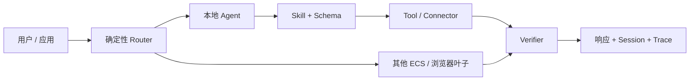

# ECS

<div align="center">

**把不确定性留给模型，把确定性留给系统。**

面向小模型、边缘设备与可信协作网络的本地优先 Agent 执行节点。

[](https://go.dev/)


[设计哲学](#设计哲学) · [可信闭环](#可信会议督办闭环) · [快速开始](#快速开始) ·
[节点与平台](#节点与平台) · [扩展](#扩展-ecs) · [许可](#许可与分享)

</div>

---

ECS 不是依赖超长 Prompt 维持秩序的 Agent 框架。

它是一层确定性的执行内核：模型负责理解、选择和表达；系统负责能力边界、Schema、授权、
状态、真实动作与验证。一个 ECS 可以独立工作，也可以与其他 ECS 组成可信协作网络。

## 设计哲学

### 小模型只处理适合它的判断

ECS 按 0.5B–4B 小模型设计，已留档验证 Qwen3 0.6B 和 1.7B。模型只理解短指令、
选择少量候选能力并组织表达；复杂路由、权限、审批、重试与工作流状态由 Go 内核承担。

### 能力是合同，不是提示词暗示

- **Tool**：一次确定性动作；
- **Skill**：能力的使用条件、依赖、风险和失败策略；
- **Agent / Pipeline**：理解、执行与验证的角色路径；
- **Office Component**：任务依赖、交接、审批与恢复组成的业务流程。

模型只看到当前平台真实可用、当前关系允许调用的少量能力。

### 发现不等于信任

节点可以变化，授权不会沿调用链自动传播。发现一个节点只说明“知道它存在”；真正协作仍需
关系凭证、Scope、Tool/Skill 白名单和目标节点的本地策略。

### 失败也必须留下答案

ECS 不追求“永远成功”，而是“不静默地错”。Session 保存连续对话，Trace 保存执行树；
Office 额外保存审批、Attempt、Outbox、Receipt、补偿和恢复状态。

## 工作方式



一次请求通常经历：能力筛选、小模型选择、Schema 转换与缺参门禁、Tool/Skill 执行、
确定性验证，以及 Session/Trace 留证。节点组支持 `single`、`broadcast`、`race` 和受深度
限制的递归调用。

当前已经具备：

- 本地优先 Go 内核与显式 OpenAI-compatible 模型配置；
- Tool、Skill、Agent、Pipeline、Office Component 分层；
- JSON Schema Draft 2020-12、Canonical Schema、确定性 Adapter 与缺参填槽；
- SKILL.md 受控 grounding 与带来源哈希的本地轻量 RAG；
- mDNS/DNS-SD、Registry、关系授权、Session、跨节点 Trace 与 Metrics；
- 人工审批、Receipt、补偿，以及 Attempt、Lease、Reaper、Outbox 和恢复状态。

## 上下文能力：明确主张 4 选 2

按 Agent Infra 赛道的四选二口径，ECS 以两项已经贯穿运行时和多节点证据链的能力作为正式
主张；本地轻量 RAG 是辅助能力，不替代这两项的工程证据。

| 主张能力 | ECS 实现 | 可验证证据 |
|---|---|---|
| **共享状态管理** | Session 保存带 owner/principal 隔离的连续上下文；Office Store 保存 WorkOrder、Stage、Approval、Attempt、Lease、Outbox、Receipt 与恢复状态 | `/v1/sessions/{id}`、Office 持久化文件、成功/失败双路径 Demo |
| **轨迹可观测** | Trace 记录 Agent → Skill → Tool/Connector 执行树，支持跨节点聚合、保留策略和 Metrics | `/v1/traces`、`?aggregate=true`、`/metrics`、三节点 Demo |

两项能力形成同一条闭环：共享状态让任务可以继续、审批和恢复；轨迹可观测让每次交接、调用、
失败与补偿都可解释、可核验。详细实现见[三节点 Demo](docs/three-node-demo.md)和
[Durable execution](docs/office-durable-execution.md)。

## 可信会议督办闭环

会议督办是 ECS 当前的主场景，也是 AgentTeams 协作层与 ECS 执行层的完整示例：

```text
会议输入
→ meeting_planner 定义范围
→ minutes_clerk / meeting.fact.extract
→ decision_reviewer / meeting.evidence.verify
→ 人工审批
→ followup_coordinator / office.action.dispatch
→ execution.receipt.verify
→ 证据归档
```

AgentTeams 负责编排、任务拆解和状态流转；ECS 负责 Stage → Skill → Connector、权限、
Schema、审批、幂等、Receipt 和 Trace。

- 责任人或期限缺失：在外部动作前阻断；
- Receipt 明确证明失败：按 Stage 合同调用补偿 Connector；
- 网络中断等结果未知：进入 `recovery_required`，沿用原业务幂等键恢复，不伪装完成。

一条命令会让成功与失败路径各连续运行 5 次，并输出结构化证据：

```bash
make demo-meeting
```

实现与证据说明：

- [GOAI 作品简介（500 字内）](docs/GOAI-作品简介.md)
- [AgentTeams 上游集成与可复现补丁](integrations/agentteams/README.md)
- [AgentTeams Task ↔ Office Stage](docs/agentteams-office-mapping.md)
- [AgentTeams Controller → ECS Worker → Office Stage 端到端证据](docs/agentteams-office-e2e.md)
- [Stage → Skill → Connector](docs/office-stage-skill-connector.md)
- [HTTP / MQTT IoT Connector](docs/iot-connectors.md)
- [人工审批](docs/office-human-approval.md)
- [Receipt、补偿与双路径](docs/office-receipt-compensation.md)
- [Durable execution](docs/office-durable-execution.md)
- [会议双路径 Demo](docs/meeting-followup-demo.md)
- [58 秒路演 Demo 视频](docs/demo-video/ecs-trusted-meeting-demo.mp4)
- [成功/失败参考运行证据](evidence/meeting-followup/README.md)
- [Qwen3 1.7B 真实双节点会议闭环证据](evidence/qwen3-1.7b-live/README.md)
- [Qwen3 0.6B 真实双节点会议闭环证据](docs/qwen3-0.6b-evaluation-report.md)

## 快速开始

需要 Go 1.25.0+ 和一个 OpenAI-compatible 模型服务；可复现交付与移动端构建固定使用
Go 1.25.12。示例使用 Ollama：

```bash
git clone https://github.com/yourblacksky/ECS.git
cd ECS
cp config.example.json config.json

ollama pull qwen3:4b-q4_K_M
ollama serve
```

`llm.model` 必须显式声明；ECS 不提供隐式模型回退。启动日志会输出最终生效的 Base URL、
模型、工具协议和 reasoning 配置。

另开终端：

```bash
make test
make run
```

使用 Codex 或其他编码 Agent 协作时，先运行 `./scripts/install-harness.sh` 启用项目 Git
hooks；Codex 还需在 `/hooks` 检查并授信项目 hook。目录职责、摘要授信与多人协作边界见
[精简 Harness 治理](docs/harness-governance.md)。`skills.d/` 属于 ECS Runtime，不是编码
Agent Skill。

```bash
curl -sS http://127.0.0.1:8090/healthz

curl -sS http://127.0.0.1:8090/v1/reply \
  -H 'Content-Type: application/json' \
  -d '{"session_id":"demo","prompt":"现在几点？","skills":["clock"]}'
```

没有真实模型时，可先停止占用 `127.0.0.1:11434` 的 Ollama，再在另一终端运行
`make mock-llm`。管理后台位于
[http://127.0.0.1:8090/admin/](http://127.0.0.1:8090/admin/)；首次本地启动会在
`data/admin.token` 生成独立管理凭证，Admin API 不接受普通节点 `auth_token`。

三个真实 ECS 节点的可复现演示：

```bash
make demo-network
make demo-network-down
```

它会验证 broadcast、recursive、真实 ToolRun、跨节点 Trace 聚合和 Metrics，并驱动完整四阶段会议督办闭环（scope → extract → verify → dispatch，含人工审批门与回执验证，stages 分布在两个 worker 节点）。详见
[三节点 Demo](docs/three-node-demo.md)。Docker 镜像包含非 root 用户、默认目录和
healthcheck；CI 会等待容器变为 `healthy`，再执行三节点 smoke test 与会议闭环验证。
本机没有 Docker 时可用 `make verify-three-node-meeting` 跑同一闭环的真实进程本地验证。

需要生成完整多平台交付物时，可以手动运行 `Manual Multiplatform Package` Actions
工作流。它在自托管 macOS Runner 上构建 Android、iOS Simulator、HarmonyOS、Windows
和 Linux ARMv6/ARM64 产物，并与经过筛选的源码及文档快照一起生成 ZIP。内部评审、
答辩备忘和备注版 PPT 不进入交付包。详见
[手动多平台打包 CI](docs/manual-multiplatform-package.md)。

## 节点与平台

发现与信任是两套机制：局域网使用 mDNS/DNS-SD，跨网络可使用 Controller Registry；
加入、配对和关系凭证决定节点真正能够调用什么。Registry 只记录“节点在哪里”，不代理任务，
也不保存信任关系。

| 平台 | 形态 | 运行边界 |
|---|---|---|
| Linux / macOS / Windows | CLI 或系统服务 | 完整节点，可执行与编排；Linux ARM 支持 Raspberry Pi |
| Android | Foreground Service | 前台 peer，支持设备能力与自动入网 |
| iOS 16+ | SwiftUI + XCFramework | 前台 leaf，退到后台时停止 |
| HarmonyOS | ArkTS + ArkUI + 内嵌 Go Runtime | 前台 peer，支持 NetworkKit mDNS 与关系鉴权 |
| 浏览器 | PWA + WebSocket | 页面活跃时工作的受限 leaf |

当前仓库提供 24 Tool、23 Skill、15 Agent、1 Pipeline 和 3 Office Component；节点只会公告
当前硬件、权限和平台真实可用的子集。桌面示例默认连接本机 Ollama，移动端评审配置可连接
DeepSeek；`local-first` 表示部署者始终可自主选择兼容模型服务，不表示所有端默认本地推理。

跨机器部署当前应使用 HTTPS、Tailscale 或 WireGuard。移动端说明：

- [Android](android/README.md)
- [iOS](ios/README.md)
- [HarmonyOS](harmonyos/README.md)

## 扩展 ECS

| 要扩展什么 | 放在哪里 |
|---|---|
| 确定性动作 | `tools.d/` + Tool Handler |
| 能力合同与 grounding | `skills.d/` + `SKILL.md` |
| 角色与执行路径 | `agents.d/`、`pipelines.d/` |
| 多人业务流程 | `office.d/` |
| 系统能力与发现协议 | `platform.Host` / Discovery Provider |

复杂能力可以让模型只面对精简 `input_schema`，再通过 `canonical_input_schema` 和
`input_adapter` 生成完整运行时对象。Skill 文档和本地知识片段必须先通过平台、角色、关系
与请求白名单筛选；grounding 不能授予新权限，也不能覆盖审批和 Office 合同。

- [Schema 与参数填槽](docs/json-schema-contracts.md)
- [Skill 文档与受控 grounding](docs/skill-documentation-grounding.md)
- [小模型调优](docs/small-model-tuning.md)
- [运行时代码组织](docs/runtime-code-organization.md)
- [版本与 Release](docs/versioning-and-releases.md)
- [部署与配置指南](docs/deployment-and-configuration.md)
- [完整配置参考](docs/configuration-reference.md)
- [公共管理与企业管理场景](docs/public-enterprise-management-overview.md)

## 常用入口

| 入口 | 用途 |
|---|---|
| `POST /v1/reply` | 本地执行 |
| `POST /v1/groups/{group}/reply` | 节点组执行 |
| `POST /v1/recursive/reply` | 递归执行 |
| `GET /v1/capabilities` | 查看当前能力 |
| `GET /v1/traces?limit=&since=` | 查看本节点 Trace |
| `GET /v1/traces/{trace}?aggregate=true` | 聚合跨节点证据树 |
| `GET /metrics` | 查看节点与执行指标 |
| `/admin/` | 管理后台 |
| `/browser/` | 浏览器叶子节点 |

## 许可与分享

ECS 采用 [Apache License 2.0](LICENSE) 开源发布。使用、修改和分发时请保留许可证与
[NOTICE](NOTICE)；第三方组件仍遵循各自许可证，详见
[第三方依赖与许可证声明](THIRD_PARTY_NOTICES.md)。密钥、个人数据、内部部署配置和未获授权
素材不属于公开授权范围，发布检查见[开源与分享规则](docs/open-source-and-sharing-policy.md)。
